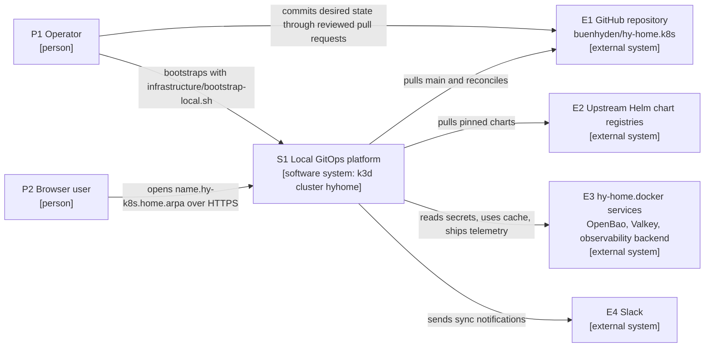
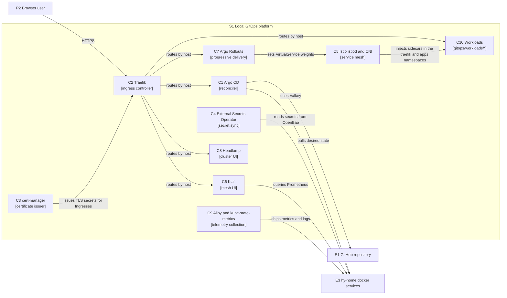

# Current Local GitOps Platform Architecture Description (AD)

## Overview

This document defines the reference architecture of the currently implemented local GitOps platform.
Current structure is described from GitOps desired state and static contract evidence.
This AD owns the durable platform view promoted from SPEC-0008; the Spec records
the implementation and its verification. Operating controls and procedures remain
with the Stage 05 owners below, and later changes use their own scoped work units.

### Current architecture summary

The current platform consists of a k3d cluster on the Linux server's native Docker Engine, the ArgoCD App-of-Apps, platform Applications, the workload ApplicationSet, and external service interface contracts.
The architecture's core goals are local reproducibility, GitOps-first ownership, secret-safe integration, and current-document traceability.

## Boundaries & Non-goals

- **Owns**:
  - Local k3d cluster configuration and bootstrap assets.
  - ArgoCD root Application, AppProjects, platform Applications, and workload ApplicationSet manifests.
  - Kubernetes interface contracts for external OpenBao (Vault API compatible), PostgreSQL, Valkey, and observability services.
  - Headlamp, Kiali, Argo Rollouts, Argo Notifications, Traefik, cert-manager, Istio, monitoring, and ESO configuration.
- **Consumes**:
  - External service runtime readiness.
  - OpenBao source secrets and operator-managed secret rotation.
  - Linux server host Docker, DNS, and network state.
- **Does Not Own**:
  - External service containers or cloud provider resources.
  - Secret values.
  - Live cluster repair without explicit approval.
- **Non-goals**:
  - Preserve old conflicting runtime values in active architecture docs.
  - Treat archive Tombstones as architecture input.

## Quality Attributes

- **Performance**: Local platform components must stay suitable for the single-host k3d resource budget ([ADR-0042](../decisions/0042-linux-server-single-host-baseline.md)).
- **Security**: Secrets are synced through ESO/OpenBao contracts ([ADR-0041](../decisions/0041-openbao-secret-backend.md)) without storing values in Git.
- **Reliability**: Desired state is expressed through GitOps manifests and static contract checks.
- **Scalability**: Workload onboarding uses ApplicationSet over `gitops/workloads/*`.
- **Observability**: Kiali and monitoring manifests integrate with external observability endpoints.
- **Operability**: Static checks and runbooks separate repo-backed validation from live runtime validation.

### Quality scenario architecture paths

The in-review [REQ-0004](../../01.requirements/0004-current-local-gitops-platform.md)
owns each scenario's measure, unit, environment, sample, and threshold or named
gap. This view identifies the current implementation path and the evidence
boundary; it does not promote a configured check or repository-static result
into an observed service-level result. [VAL-P08-018](../../03.specs/0106-stage99-lifecycle-normalization/spec.md#success-criteria--verification-plan)
owns this change's local review, not future operator observations.

| Requirement scenario | Architecture source and response | Evidence boundary and operating owner |
| --- | --- | --- |
| [GitOps reproducibility](../../01.requirements/0004-current-local-gitops-platform.md#quality-scenario-gitops-reproducibility) ([REQ-0004-FR-0008](../../01.requirements/0004-current-local-gitops-platform.md)) | The [root Application](../../../gitops/clusters/local/root-application.yaml), [platform Applications](../../../gitops/apps/root/), and workload ApplicationSet declare the reconciliation graph. [Platform assurance](../../../scripts/validation/platform/assurance.py) checks reviewed inputs. | Repository render, schema, and reference checks are static evidence; ArgoCD sync and health require separate cluster observation by the Platform Owner under [POL-0001](../../05.operations/policies/0001-k8s-gitops-operations-policy.md) and [RUN-0001](../../05.operations/runbooks/0001-argocd-platform-bootstrap-runbook.md). |
| [Secret and TLS recovery](../../01.requirements/0004-current-local-gitops-platform.md#quality-scenario-secret-tls-recovery) ([REQ-0004-FR-0003](../../01.requirements/0004-current-local-gitops-platform.md), [REQ-0004-NFR-0002](../../01.requirements/0004-current-local-gitops-platform.md)) | [ESO declarations](../../../gitops/platform/eso/), the CoreDNS host mapping, and the gateway CA connect the cluster to external OpenBao without storing secret values here. | Static endpoint and secret-reference checks do not prove OpenBao availability, successful authentication, or recovery. The approved operator observes store/ExternalSecret status and TLS through [RUN-0002](../../05.operations/runbooks/0002-argocd-eso-vault-recovery-runbook.md); the external service owner handles OpenBao state. |
| [External interface](../../01.requirements/0004-current-local-gitops-platform.md#quality-scenario-external-interface) ([REQ-0004-FR-0003](../../01.requirements/0004-current-local-gitops-platform.md)) | [Service and EndpointSlice declarations](../../../gitops/platform/external-services/) describe cluster-facing data and telemetry interfaces; [ADR-0044](../decisions/0044-stateful-data-stores-stay-external.md) and [ADR-0046](../decisions/0046-external-services-over-host-addresses.md) keep the stateful runtime outside the cluster. | A matching declaration is static evidence only. [RUN-0001](../../05.operations/runbooks/0001-argocd-platform-bootstrap-runbook.md) routes approved connectivity checks to the Platform Owner, while the external workspace owns service uptime and backups. |
| [Telemetry visibility](../../01.requirements/0004-current-local-gitops-platform.md#quality-scenario-telemetry) ([REQ-0004-NFR-0001](../../01.requirements/0004-current-local-gitops-platform.md)) | [In-cluster Alloy](../../../gitops/platform/monitoring/) collects metrics and logs; [ADR-0045](../decisions/0045-in-cluster-telemetry-collection.md) places storage and query behind external Prometheus and Loki. | Declarative scrape and remote-write routes do not prove receipt. The Observability Owner uses [POL-0005](../../05.operations/policies/0005-observability-platform-operations-policy.md), [RUN-0008](../../05.operations/runbooks/0008-argocd-metrics-prometheus-runbook.md), and [RUN-0009](../../05.operations/runbooks/0009-k8s-observability-runbook.md) for authorized target and stream observations. |
| [Workload onboarding](../../01.requirements/0004-current-local-gitops-platform.md#quality-scenario-workload-onboarding) ([REQ-0004-NFR-0001](../../01.requirements/0004-current-local-gitops-platform.md)) | The [workload ApplicationSet](../../../gitops/clusters/local/applicationset-apps.yaml) scans [workload declarations](../../../gitops/workloads/); their Rollout and AnalysisTemplate definitions provide a component-specific progressive-delivery path. | Manifest checks prove declared structure, not a successful rollout or universal availability. The application and Platform Owners capture actual Application, Rollout, pod, ingress, and TLS state under [POL-0007](../../05.operations/policies/0007-app-gitops-onboarding-policy.md) and [RUN-0010](../../05.operations/runbooks/0010-github-app-gitops-onboarding-runbook.md). |
| [Single-host recovery](../../01.requirements/0004-current-local-gitops-platform.md#quality-scenario-single-host-recovery) ([REQ-0004-NFR-0001](../../01.requirements/0004-current-local-gitops-platform.md)) | [k3d configuration](../../../infrastructure/k3d/k3d-cluster.yaml) and bootstrap assets implement the local single-host baseline selected by [ADR-0042](../decisions/0042-linux-server-single-host-baseline.md). | Static topology and resource preflight do not establish high availability or recovery duration. The Platform Owner records any approved rebuild and service-state observation through [POL-0001](../../05.operations/policies/0001-k8s-gitops-operations-policy.md) and [RUN-0001](../../05.operations/runbooks/0001-argocd-platform-bootstrap-runbook.md). |

## System Overview & Context

The root application in `gitops/clusters/local/root-application.yaml` points to `gitops/apps/root`.
Platform Applications then install or configure ArgoCD, namespaces, cert-manager, Traefik, ESO, external services, Headlamp, Istio/Kiali, monitoring, Rollouts, and network policies.
The apps ApplicationSet owns workload directories under `gitops/workloads/*`.

### System context and container views

These views follow the [C4 model](https://c4model.com/): a context view of the
platform and its neighbours, and a container view of what runs inside it. A
C4 container is a separately running application or data store, so one
container here can span several Pods, and a namespace or Docker container is
not a C4 container by itself. Readers are the operator and reviewers of
platform changes. The Mermaid source below is the editable source; GitHub
renders it. Identifiers `P`, `S`, `E` and `C` are stable: a person, the
system in scope, an external system and a container. Arrows point from the
element that starts the interaction. The views omit the Kubernetes control
plane, CoreDNS and MetalLB, which are deployment infrastructure.

**System context (S1).**

**Containers inside S1.** Argo CD (C1) applies the manifests of every other
container; that relationship is in the table, not drawn.

| ID | Element | Responsibility | Technology and namespace | Source |
| --- | --- | --- | --- | --- |
| C1 | Argo CD | Reconciles the root Application, platform Applications and workload ApplicationSet; applies every other container's manifests; sends notifications to E4 | Argo CD Helm release, `argocd` | [cluster declarations](../../../gitops/clusters/local/), [Argo CD config](../../../gitops/platform/argocd/) |
| C2 | Traefik | Terminates HTTPS for `<name>.hy-k8s.home.arpa` and routes by host | Traefik chart, `traefik` | [Application](../../../gitops/apps/root/platform-traefik-app.yaml) |
| C3 | cert-manager | Issues Ingress TLS certificates from `mkcert-ca-issuer` | cert-manager chart, `cert-manager` | [cert-manager](../../../gitops/platform/cert-manager/) |
| C4 | External Secrets Operator | Syncs secrets from OpenBao through `vault-backend` | External Secrets chart, `external-secrets` | [ESO](../../../gitops/platform/eso/) |
| C5 | Istio istiod and CNI | Mesh control plane for the `traefik` and `apps` namespaces | Istio charts, `istio-system` | [istiod](../../../gitops/apps/root/platform-istiod-app.yaml) |
| C6 | Kiali | Mesh UI backed by the external Prometheus | Kiali operator, `istio-system` | [Kiali](../../../gitops/platform/kiali/) |
| C7 | Argo Rollouts | Canary steps with Istio traffic routing and analysis | Argo Rollouts chart, `argo-rollouts` | [Application](../../../gitops/apps/root/platform-rollouts-app.yaml) |
| C8 | Headlamp | Cluster UI | Headlamp chart, `headlamp` | [Headlamp](../../../gitops/platform/headlamp/) |
| C9 | Alloy and kube-state-metrics | Collect metrics and logs and send them to the external backend | Kustomize manifests, `monitoring` | [monitoring](../../../gitops/platform/monitoring/) |
| C10 | Workloads | Application workloads onboarded by the ApplicationSet, currently Adminer | Kustomize per workload, `apps` | [workloads](../../../gitops/workloads/) |

### Current platform sources and operating owners

| Boundary | Current source and contract | Operating owner |
| --- | --- | --- |
| Reconciliation and permissions | [Cluster declarations](../../../gitops/clusters/local/) own the root Application, AppProjects and workload ApplicationSet; the root targets `gitops/apps/root`, and the ApplicationSet scans `gitops/workloads/*`. [Platform Applications](../../../gitops/apps/root/) and [namespace declarations](../../../gitops/platform/namespaces/) own platform desired state. | [POL-0001](../../05.operations/policies/0001-k8s-gitops-operations-policy.md), [RUN-0001](../../05.operations/runbooks/0001-argocd-platform-bootstrap-runbook.md) |
| Host and browser entry | [k3d config](../../../infrastructure/k3d/k3d-cluster.yaml) binds the API to `192.168.0.13:6550` and serverlb to `192.168.0.14:80/443`, forwarding to Traefik NodePorts `30080/30443` (Service `traefik/traefik`, MetalLB `172.18.0.240`; [ADR-0050](../decisions/0050-ingress-nginx-replacement-with-traefik.md)). k8s hosts use `<name>.hy-k8s.home.arpa` (`argo` for ArgoCD); [apex redirects](../../../gitops/platform/ingress-routes/) send `hy-k8s.home.arpa/<name>` to the HTTPS subdomain with 301. The external Traefik carries no k8s route (ADR-0042, ADR-0043, ADR-0046). | [RUN-0001](../../05.operations/runbooks/0001-argocd-platform-bootstrap-runbook.md); operator owns host addresses and name resolution |
| External secrets | [ESO configuration](../../../gitops/platform/eso/) uses the `vault-backend` store and Vault API provider to reach external OpenBao at `https://openbao.hy.home.arpa` with a pinned CA. Bootstrap owns the CoreDNS host mapping and CA distribution; secret values stay outside Git (ADR-0041, ADR-0046). | [POL-0001](../../05.operations/policies/0001-k8s-gitops-operations-policy.md), [RUN-0002](../../05.operations/runbooks/0002-argocd-eso-vault-recovery-runbook.md) |
| External data services | [Service and EndpointSlice manifests](../../../gitops/platform/external-services/) retain only the required management Valkey interface `valkey-external:6379` → host `192.168.0.13:26379` for ArgoCD. The external `hy-home.docker` source publishes `mng-pg` at `127.0.0.1:25432` and `dev-pg` at `127.0.0.1:25433`; `dev-valkey` exposes `6379` only in `dev_data_net`. No PostgreSQL or development Valkey K8s Service/EndpointSlice or LAN endpoint is declared. The former `postgres-ha`/`pg-router` write/read routes are retired from this repository; Valkey cluster had no K8s consumer. Earlier live samples refer to their dated source. Adminer has no default database server in current local source. A future K8s-to-PostgreSQL path requires a separately reviewed connection, policy and secret design; loopback TCP and container health do not establish that path. [ADR-0049](../decisions/0049-external-data-service-contract-alignment.md) is the accepted scoped amendment; its acceptance does not establish live reconciliation or database reachability. | [RUN-0001](../../05.operations/runbooks/0001-argocd-platform-bootstrap-runbook.md), [POL-0001](../../05.operations/policies/0001-k8s-gitops-operations-policy.md); external workspace owns data runtime and backups |
| Telemetry and service UIs | [Alloy](../../../gitops/platform/monitoring/), [Kiali](../../../gitops/apps/root/platform-kiali-app.yaml) and [Rollouts](../../../gitops/apps/root/platform-rollouts-app.yaml) use the external observability backend. Prometheus and Grafana use HTTPS gateway names, authentication and CA verification; Loki, Tempo and Alloy OTLP retain Service/EndpointSlice interfaces. Metrics collection stays in-cluster; storage stays external (ADR-0037, ADR-0045, ADR-0046). | [RUN-0009](../../05.operations/runbooks/0009-k8s-observability-runbook.md), [POL-0003](../../05.operations/policies/0003-service-mesh-cert-manager-policy.md) |

The executable sources own exact values and versions. These boundaries and the
accepted decisions explain their purpose; neither a document nor a static PASS
proves current external availability, secret provisioning or live reconciliation.

### Delivery assurance architecture transferred from AD-0010

This AD inherits AD-0010's boundaries for platform validation, interfaces, examples, source revisions, and namespace evidence.
[AD-0006](./0006-workspace-agent-governance-platform.md) and
[REQ-0003](../../01.requirements/0003-workspace-agent-governance-platform.md) co-own the common affected-path, CI, approval, and review obligations.
[REQ-0004](../../01.requirements/0004-current-local-gitops-platform.md) states the per-member succession of the current platform requirements.

| Surface or flow | Current source / implementation owner | Evidence boundary |
| --- | --- | --- |
| Desired-state tree | [root Application](../../../gitops/clusters/local/root-application.yaml), [root kustomization](../../../gitops/apps/root/kustomization.yaml) | The static structure of root → platform Applications / workload ApplicationSet, not live reconciliation evidence |
| Local runtime and namespace policy | [k3d config](../../../infrastructure/k3d/k3d-cluster.yaml), [namespace declarations](../../../gitops/platform/namespaces/) | Enforce only on workloads the repository owns and validates statically; chart/injection uncertainty is audit/warn |
| Dispatch and GitHub projections | [Validation Registry](../../../scripts/validation/registry.json), [.github](../../../.github/) | The Registry owns lanes and argv; labels/CODEOWNERS projection parity remains an unassigned assurance residual after Spec 0048 was withdrawn without a successor |
| Platform verification | [Validation Registry](../../../scripts/validation/registry.json), [platform assurance](../../../scripts/validation/platform/assurance.py), [static contract checks](../../../scripts/validate-infrastructure-contracts.sh) | Affected-path and exact-index staged selection compose syntax, structure, policy and product checks with the offline render/schema purpose gate. Per-target evidence identifies depth, tool/version, fallback and result; the runner owns the execution lane. Live observation remains separate. |
| Cloud examples | [AWS](../../../examples/aws/README.md), [Azure](../../../examples/azure/README.md) | Terraform/Bicep format/validate/lint/build; provider credentials, apply, or deploy need separate approval |
| Local browser/service transport | [k8s router](../../../infrastructure/k3d/k3d-cluster.yaml), [apex redirects](../../../gitops/platform/ingress-routes/), [external service interfaces](../../../gitops/platform/external-services/) | Check the dedicated k8s router (ADR-0043) and the local-only transport exceptions without widening an exception into a general security allowance |

Each product validator owns its own area: Kubernetes GVKs, the k8s router contract, GitOps
structure, policy, and the Vault/ESO source and secret boundary. A missing tool, malformed
input, an unsafe path, and a fallback each need a direct negative fixture, and a required-tool
failure is not hidden as a SKIP.

The platform assurance gate runs when selected by affected paths or the staged
index under the Validation Registry. It renders reviewed local GitOps and sample-app roots
with an immutable Kustomize tool and validates covered built-in GVKs with the
existing JSON Schema engine and a pinned offline Kubernetes schema corpus.
The [schema manifest](../../../scripts/validation/platform/schemas/manifest.json)
owns its source identities; executable inputs own the roots, tool versions and
supported kinds. Local-only loading rejects unsafe paths, remote resources and
unreviewed loading directives before rendering. This choice reuses the upstream
renderer and installed schema engine; a local renderer implementation or a
second schema CLI would duplicate their responsibilities. Remote bases,
generators and plugin flexibility are outside the reviewed loading contract.
Retired full/CI sweeps are not completion gates. Hosted metadata and selected
style checks have their own observed inputs and cannot certify local platform
assurance or live cluster health.

[Platform reference checks](../../../scripts/validation/platform/ingress.py)
resolve rendered Ingress class, host, TLS, namespace, backend Service and port
references. Tracked resources are distinguished from explicitly declared
chart/operator-owned outputs. AppProject checks use group/kind identity and
verify repository source, revision, path, project assignment and the `argocd`
namespace of control resources. Existing structure checks retain their scoped
root and ApplicationSet destination assertions; these checks do not establish
general Application destination authorization. Unknown GVKs or broken checked
declarations fail closed. Known custom GVKs without vendored
schemas carry an explicit schema `DEFER`; their product checks do not become
API-schema evidence. Helm-generated Argo CD and Rollouts routes and generated
Service references retain declaration-only evidence. API-server admission,
generated runtime output, the Argo CD renderer's version parity and live
reconciliation require separately authorized observation.

Exact chart, infrastructure, workflow, dependency, and example versions live in the executable
source or a reviewed lock. The Stage 90 version mirror is not an execution precondition.
The repository's own source uses `targetRevision: main`, as
[ADR-0029](../decisions/0029-mutable-target-revision-retention.md) decided, kept distinct from the
exact revisions of external charts; the branch policy is revisited when multiple operators,
multiple environments, or history rewriting are introduced.
Images keep the current non-latest tag-or-digest check, with no unverified blanket digest change.
Further digest/SBOM/provenance obligations are approved follow-on work with a consumer, owner, and trigger.
The Istio CNI manifest is desired state and proves no actual admission or network state.

### Implementation owners and remaining boundaries

Spec 0049 depended on the retired Spec 0048 and the Traefik lane and was withdrawn on 2026-09-25 ([SPEC-0089](../../98.archive/completed/03.specs/0089-deferred-conflict-resolution/spec.md)); it is kept in `98.archive/retired/` and not cited ([SPEC-0090](../../98.archive/completed/03.specs/0090-spec0049-retirement/spec.md)). [SPEC-0104](../../98.archive/completed/03.specs/0104-platform-validation-assurance/spec.md) delivered repository-static acceptance evidence for REQ-0004-FR-0008 and REQ-0004-FR-0010: offline render/built-in schema checks, per-target depth/tool-version/fallback results and ingress/resource-kind reference integrity. It extends the existing structure, YAML, required policy-tool, secret, Vault/ESO and product checks without restoring the retired Traefik lane. This AD and ADR-0043 retain the current ingress architecture; the completed Spec's Tasks record delivery evidence and explicit custom-CRD-schema, generated-output and live-observation DEFER owners and retry conditions. SPEC-0008 completion remains evidence for its original scope.
GitHub routing/CI (Spec 0048), native IaC/direct negative fixtures (Spec 0050),
the final local-only integration (Spec 0051), and surface/hunk reconciliation (Spec 0047) were withdrawn without successors
and kept in `98.archive/retired/` ([SPEC-0087](../../98.archive/completed/03.specs/0087-stage03-terminal-package-retention/spec.md));
their scope currently has no implementation owner. The AD succession does not mean any tranche or WP-013 is complete.
[SPEC-0115](../../03.specs/0115-r10-local-remediation/spec.md) owns the current
scoped verifier and ESO consumer repairs under VAL-R10-008; its Task records
selected static results and any separately authorized live observation. This
follow-up does not reopen the withdrawn packages or certify live readiness.

## Data Architecture

- **Key Entities / Flows**:
  - ArgoCD reconciles Git manifests into the local cluster.
  - ESO reads approved OpenBao paths through the `vault-backend` ClusterSecretStore and its Vault-API `vault` provider.
  - External service `Service` and `EndpointSlice` resources expose data and selected telemetry interfaces to workloads; OpenBao, Prometheus and Grafana use the HTTPS gateway paths defined by ADR-0046.
- **Storage Strategy**:
  - Runtime data remains in external PostgreSQL, Valkey, OpenBao, and observability services.
  - This repository stores only interface contracts and configuration.
- **Data Boundaries**:
  - Secret values, tokens, and private keys stay outside Git.
  - Active docs store current contract facts only.

## Infrastructure & Deployment

- **Runtime / Platform**:
  - Linux server shell with the native Docker Engine.
  - k3d cluster named `hyhome`.
  - Traefik behind the dedicated k8s router (k3d serverlb on `192.168.0.14:443`) for browser access at `<name>.hy-k8s.home.arpa` ([ADR-0043](../decisions/0043-dedicated-k8s-ingress-router.md)).
- **Deployment Model**:
  - Bootstrap installs the initial ArgoCD boundary.
  - Steady-state changes flow through Git and ArgoCD reconciliation.
- **Operational Evidence**:
  - `bash scripts/validate-infrastructure-contracts.sh`
  - `bash scripts/validate-gitops-structure.sh`
  - `bash scripts/validate-k8s-manifests.sh .`

### Deployment mapping

| Deployment node | Hosts | Source |
| --- | --- | --- |
| Linux server with the native Docker Engine | The k3d node containers and the k3d server load balancer; API at `192.168.0.13:6550`, browser entry at `192.168.0.14:80/443` | [k3d config](../../../infrastructure/k3d/k3d-cluster.yaml), [ADR-0042](../decisions/0042-linux-server-single-host-baseline.md) |
| k3d cluster `hyhome` | Containers C1 to C10 in the namespaces listed above | [namespaces](../../../gitops/platform/namespaces/) |
| k3d load balancer to Traefik | Forwards to NodePorts `30080/30443`; MetalLB also gives Service `traefik/traefik` the address `172.18.0.240` | [ADR-0050](../decisions/0050-ingress-nginx-replacement-with-traefik.md), [MetalLB pool](../../../infrastructure/ipaddresspool.yaml) |
| hy-home.docker workspace on the same host | E3: OpenBao, management Valkey and the observability backend | [external services](../../../gitops/platform/external-services/), [ADR-0046](../decisions/0046-external-services-over-host-addresses.md) |

### Agent architecture requirements

- **Model/Provider Strategy**: Provider adapters must route to Common agent governance and current active docs.
- **Tooling Boundary**: Agents may inspect and edit repo files inside the workspace; live mutation requires approval.
- **Memory & Context Strategy**: durable execution evidence goes in the package-local Task, common rules in `.agents/governance/`, and temporary checkpoints in ignored recovery state.
- **Guardrail Boundary**: Superseded/ended records are non-authoritative history; completed packages retain their own types under ADR-0038.
- **Latency / Cost Budget**: Not applicable to platform runtime.

## Traceability

### Lifecycle Traceability

ADR links identify durable decisions. SPEC-0008 links identify the implementing
work and its evidence; they do not delegate the current architecture back to a
completed work unit.

| Upstream requirement | Quality attribute or boundary | ADR / Spec |
| --- | --- | --- |
| [REQ-0004-FR-0001](../../01.requirements/0004-current-local-gitops-platform.md) | Desired-state root ownership of clusters, root apps, platform, and workloads | [ADR 0014](../decisions/0014-current-local-gitops-platform-contract.md) and [Spec 008](../../98.archive/completed/03.specs/0008-current-local-gitops-platform/spec.md) |
| [REQ-0004-FR-0002](../../01.requirements/0004-current-local-gitops-platform.md) | The App-of-Apps and ApplicationSet reconciliation boundary | [ADR 0014](../decisions/0014-current-local-gitops-platform-contract.md) and [Spec 008](../../98.archive/completed/03.specs/0008-current-local-gitops-platform/spec.md) |
| [REQ-0004-FR-0003](../../01.requirements/0004-current-local-gitops-platform.md) | Separation of the external runtime from the Kubernetes Service/EndpointSlice interface | [ADR 0014](../decisions/0014-current-local-gitops-platform-contract.md) and [Spec 008](../../98.archive/completed/03.specs/0008-current-local-gitops-platform/spec.md) |
| [REQ-0004-FR-0004](../../01.requirements/0004-current-local-gitops-platform.md) | Separation of the current Headlamp UI from archived UI history | [ADR 0014](../decisions/0014-current-local-gitops-platform-contract.md) and [Spec 008](../../98.archive/completed/03.specs/0008-current-local-gitops-platform/spec.md) |
| [REQ-0004-FR-0008](../../01.requirements/0004-current-local-gitops-platform.md) | Composed per-target validation depths with explicit tool, fallback, execution lane and result; static and live evidence stay distinct | [SPEC-0104](../../98.archive/completed/03.specs/0104-platform-validation-assurance/spec.md) |
| [REQ-0004-FR-0010](../../01.requirements/0004-current-local-gitops-platform.md) | Fail-closed resource and ingress reference integrity with explicit chart/operator declaration boundaries and preserved policy/secret checks | [ADR-0043](../decisions/0043-dedicated-k8s-ingress-router.md) and [SPEC-0104](../../98.archive/completed/03.specs/0104-platform-validation-assurance/spec.md) |
| [REQ-0004-NFR-0001](../../01.requirements/0004-current-local-gitops-platform.md) | The explicit scope of the current platform component graph | [ADR 0014](../decisions/0014-current-local-gitops-platform-contract.md) and [Spec 008](../../98.archive/completed/03.specs/0008-current-local-gitops-platform/spec.md) |
| [REQ-0004-NFR-0002](../../01.requirements/0004-current-local-gitops-platform.md) | The trust boundary between ESO/Vault references and secret values | [ADR 0014](../decisions/0014-current-local-gitops-platform-contract.md) and [Spec 008](../../98.archive/completed/03.specs/0008-current-local-gitops-platform/spec.md) |
| [REQ-0004-IF-0001](../../01.requirements/0004-current-local-gitops-platform.md) | The authority boundary between the active current contract and archive Tombstones | [ADR 0014](../decisions/0014-current-local-gitops-platform-contract.md) and [Spec 008](../../98.archive/completed/03.specs/0008-current-local-gitops-platform/spec.md) |
| N/A — [Acceptance criterion 01](../../01.requirements/0004-current-local-gitops-platform.md) remains package-owned | Repo-backed evidence owned by static contract verification | [ADR 0014](../decisions/0014-current-local-gitops-platform-contract.md) and [Spec 008](../../98.archive/completed/03.specs/0008-current-local-gitops-platform/spec.md) |
| N/A — [Acceptance criterion 02](../../01.requirements/0004-current-local-gitops-platform.md) remains package-owned | Structure validation evidence for root, platform, and workload | [ADR 0014](../decisions/0014-current-local-gitops-platform-contract.md) and [Spec 008](../../98.archive/completed/03.specs/0008-current-local-gitops-platform/spec.md) |
| N/A — [Acceptance criterion 03](../../01.requirements/0004-current-local-gitops-platform.md) remains package-owned | tracked Kubernetes manifest syntax evidence | [ADR 0014](../decisions/0014-current-local-gitops-platform-contract.md) and [Spec 008](../../98.archive/completed/03.specs/0008-current-local-gitops-platform/spec.md) |
| N/A — [Acceptance criterion 04](../../01.requirements/0004-current-local-gitops-platform.md) remains package-owned | Active/archive currentness evidence from the repository quality gate | [ADR 0014](../decisions/0014-current-local-gitops-platform-contract.md) and [Spec 008](../../98.archive/completed/03.specs/0008-current-local-gitops-platform/spec.md) |

### arc42 coverage

The twelve [arc42](https://arc42.org/overview/) sections are used as a
content check, not as a required layout. Each row names where the content
lives; nothing is copied between this description, the ADRs and REQ-0004.

| arc42 section | Where it is covered | Gap or reason |
| --- | --- | --- |
| 1 Introduction and goals | [Overview](#overview); REQ-0004 | none |
| 2 Constraints | [Boundaries & Non-goals](#boundaries--non-goals); ADR-0042, ADR-0044 | none |
| 3 Context and scope | [System context view](#system-context-and-container-views); [platform sources](#current-platform-sources-and-operating-owners) | none |
| 4 Solution strategy | [Current architecture summary](#current-architecture-summary); ADR-0002, ADR-0014 | none |
| 5 Building block view | [Container view and element table](#system-context-and-container-views) | No component view; components are product internals of upstream charts |
| 6 Runtime view | Reconciliation and delivery prose in this section; canary flow in AD-0004 | No dynamic diagram; add one when a multi-step flow needs review |
| 7 Deployment view | [Infrastructure & Deployment](#infrastructure--deployment) and its deployment mapping | none |
| 8 Crosscutting concepts | TLS (ADR-0006), secrets (ADR-0041), mesh (ADR-0008), pod security (ADR-0028), external services (ADR-0046) | Kept in the ADRs, not repeated here |
| 9 Architecture decisions | The [decision log](../decisions/) | none |
| 10 Quality requirements | [Quality Attributes](#quality-attributes); REQ-0004 scenarios | Measured values remain operator observations |
| 11 Risks and technical debt | [Implementation owners and remaining boundaries](#implementation-owners-and-remaining-boundaries) | No separate risk register; residuals stay with their owners |
| 12 Glossary | none | Omitted; the description uses product names, and SDLC terms live in `.agents/governance/sdlc.md` |

### Transferred requirement members

| Current requirement | Retained architecture boundary | Implementation owner |
| --- | --- | --- |
| REQ-0004-FR-0005, REQ-0004-FR-0006 | Source inventory and resumed-change semantic ownership | None; Spec 0047 was withdrawn without a successor |
| REQ-0004-FR-0007 | Single routing owner with GitHub-native projections | AD-0006; Spec 0048 was withdrawn without a successor |
| REQ-0004-FR-0008, REQ-0004-FR-0010 | Delivered repository-static layered validation evidence and fail-closed platform reference integrity | [SPEC-0104](../../98.archive/completed/03.specs/0104-platform-validation-assurance/spec.md); current ingress sources and operating owners are named above, with custom-schema, generated-output and live-observation DEFER explicitly reported |
| REQ-0004-FR-0014, REQ-0004-NFR-0003 | Namespace and artifact assurance | Existing validators retain their current coverage; conditional digest/SBOM/provenance follow-on remains as stated above and is outside SPEC-0104 |
| REQ-0004-FR-0009 | Example-adjacent native validation without cloud deployment | None; Spec 0050 was withdrawn without a successor |
| REQ-0004-FR-0011 | Ordered review/rollback boundaries and local-only integration | None; Spec 0051 was withdrawn without a successor |
| REQ-0004-FR-0012, REQ-0004-FR-0013 | Direct executable-source versions and self-source/external-source distinction | Executable manifests and ADR-0029 |

Original AD-0010 and REQ-0007 program identity remain historical lineage. These current boundaries
do not rewrite which description the original ADRs served; superseded bodies are retained under `98.archive/superseded/`.

- **Requirement**: [../../01.requirements/0004-current-local-gitops-platform.md](../../01.requirements/0004-current-local-gitops-platform.md)
- **Implementation evidence**: [SPEC-0008](../../98.archive/completed/03.specs/0008-current-local-gitops-platform/spec.md); current structure is owned here, operating controls by the named Stage 05 documents.
- **Plan**: [../../04.execution/plans/2026-06-02-current-implementation-docs-alignment.md](../../98.archive/README.md#document-index)
- **ADR**: [../decisions/0014-current-local-gitops-platform-contract.md](../decisions/0014-current-local-gitops-platform-contract.md)
- **Archive Index**: [../../98.archive/README.md](../../98.archive/README.md)
